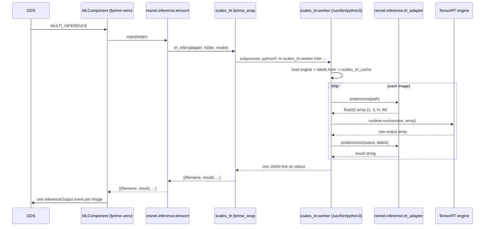

# Scales-ML Repository Guide

> **Superseded for the flight inference path (2026-11-13).** The inference
> pipeline, the CUDA setup (`make jetson-setup`, `ml-venv`), ResNet-18
> internals, and adding a model are now documented inside the submodule:
> `Scales-ML/README.md` and `Scales-ML/docs/` (`inference-pipeline.md`,
> `resnet-18.md`, `adding-a-model.md`). Statements below about running torch in
> `fprime-venv`, the `/usr/bin/python3` TensorRT interpreter, bilinear
> preprocessing, and the CUDA stream race are out of date. The experiments
> section below is still accurate.

`Components/MLComponent/Scales-ML/` is a git submodule
([BroncoSpace-Lab/Scales-ML](https://github.com/BroncoSpace-Lab/Scales-ML/tree/c49ad8f190e4c10a08b7b1cdb475192e059cb833))
holding the machine-learning code for SCALES. It contains two kinds of code:

- **Flight inference code** -- `scales_trt/`, `resnet/inference/`,
  `yolo/inference/`. `MLComponent` imports these modules and runs them in
  response to ground commands.
- **Experiments** -- every other file. Standalone scripts used to evaluate
  models, speed, and power draw on the Jetson AGX. F Prime never calls them.

This page describes Scales-ML at commit `c49ad8f`. Paths are relative to
`Scales-ML/` unless noted. For the F Prime component that calls this code,
see [sdd.md](sdd.md).

## Background

### ML terms

| Term | Meaning |
|---|---|
| Model | A function with many tunable parameters that maps an input (an image) to an output (class scores, boxes, a depth map). |
| Weights | The tuned parameter values, stored in a file (`.pth`, `.pt`, `.h5`, `.safetensors`). Git-ignored; downloaded or produced by training. |
| Training | Adjusting weights with labeled examples until the output error (*loss*) is low. GPU-heavy. Done only in `mnist/` and `resnet/resnet_training_hg.py`. |
| Inference | Running a trained model on new input to get a prediction. This is what flight software does. |
| Pretrained model | Weights published by someone else and downloaded by name from the Hugging Face Hub (e.g. `microsoft/resnet-18`). Downloaded on first use, then cached in `~/.cache/huggingface`; the first run needs network access. |
| Tensor | An N-dimensional array of numbers -- the data type models consume and produce. Images are passed as `[N, C, H, W]` (batch size, color channels, height, width), called *NCHW*. |
| Preprocessing | Converting a raw image into the exact tensor format the model was trained on (size, value range, normalization). A mismatch gives wrong answers, not errors. |
| Logits / argmax | A classifier outputs one score per class (*logits*). The index of the largest score (*argmax*) is the predicted class; a label table maps index to name. |
| Postprocessing | Converting raw model output into a usable result, here a short string per image. |
| Classification / detection | Classification: one label per image (ResNet). Detection: a box and label for each object in the image (YOLO). |
| Datasets | MNIST: 28x28 grayscale digits, 10 classes. CIFAR-100: 32x32 color images, 100 classes. ImageNet: 1,000 classes; the pretrained ResNets output ImageNet labels. COCO: 80 object classes; the YOLOv8 labels. |
| CUDA / device | NVIDIA GPU computing. Code selects `cuda` if a GPU is available, otherwise `cpu`. |
| ONNX | A framework-neutral model file format. Used here to hand a model from PyTorch to TensorRT. |
| TensorRT engine | A model compiled by NVIDIA TensorRT for one specific GPU and TensorRT version. Faster than PyTorch; slow to build; not portable between machines. |
| FP32 / FP16 | 32-bit vs 16-bit floating point. FP16 engines run faster and use less memory at a small accuracy cost. |
| NMS | Non-maximum suppression: removes duplicate, overlapping detection boxes for the same object. |
| FPS | Frames (images) processed per second; the throughput metric in the benchmarks. |

### Python terms

| Term | Meaning |
|---|---|
| Script | A `.py` file run directly: `python3 file.py`. |
| Module | A `.py` file loaded by another file: `import resnet_cifar100`. |
| Package | A folder containing `__init__.py`. Its modules are imported with dotted names: `resnet.inference.pytorch` is the file `resnet/inference/pytorch.py`. |
| `PYTHONPATH` | Directories Python searches for imports. For a dotted name, the directory that *contains* the top-level package must be listed -- here, `Scales-ML/` itself. |
| `if __name__ == "__main__":` | Code under this line runs only when the file is executed directly, not when it is imported. Lets one file serve as both an F Prime-callable module and a command-line tool. |
| Virtual environment | An isolated Python installation with its own packages. F Prime runs in `fprime-venv`; TensorRT is installed for the Jetson system Python, `/usr/bin/python3`. |
| Subprocess | A separate OS process started from Python with `subprocess.run`. Used here to run TensorRT under the system Python. |
| Environment variable | A key/value setting inherited by child processes, read with `os.environ.get("NAME", default)`. Used here for configuration. |
| pickle | Python's binary object format. Loading a pickle can execute code, so only load trusted files. `.pt` weights and the `nannyml/*_df` files are pickles. |

## Layout

```
Scales-ML/
├── README.md                 How to add a new model to F Prime
├── scales_trt/               [flight] Shared TensorRT runtime + F Prime bridge
│   ├── runtime.py            Build, load, and run TensorRT engines
│   ├── worker.py             Command-line tool run as a subprocess: prepare | infer
│   ├── fprime_wrap.py        Starts the worker and parses its JSON reply
│   └── jetson_compat.py      Workarounds for Jetson PyTorch/torchvision builds
├── resnet/
│   ├── inference/            [flight]
│   │   ├── pytorch.py        ResNet-18 with PyTorch, inside F Prime's process
│   │   ├── tensorrt.py       ResNet-18 with TensorRT (entry point)
│   │   └── trt_adapter.py    ResNet ONNX export, preprocess, postprocess
│   ├── resnet_cifar100.py    Classify CIFAR-100 test images, print results
│   ├── resnet_fps.py         Throughput benchmark
│   └── resnet_training_hg.py Train ResNet-50 on CIFAR-100, upload to Hugging Face
├── yolo/
│   ├── inference/            [flight]
│   │   ├── pytorch.py        YOLOv8n with ultralytics (subprocess)
│   │   ├── tensorrt.py       YOLOv8n with TensorRT (entry point)
│   │   └── trt_adapter.py    YOLO ONNX export, preprocess, postprocess
│   ├── camera.py             Live USB-camera detection demo
│   └── camera_torch.py       Same, with manual GPU tensor handling
├── mnist/                    Train, evaluate, and export a digit classifier
├── depth/                    Depth Anything V2 depth-estimation tests
├── phi3/                     Phi-3.5-mini language model speed test
├── nannyml/                  Estimating model accuracy without labels
├── hugging_face/misc/        Audio dataset preparation (incomplete)
└── tegrastats_avg.py         Summarize Jetson power/thermal/RAM logs
```

`__init__.py` files (not shown) make `Scales-ML/`, `resnet/`, `yolo/`,
`scales_trt/`, and each `inference/` folder importable as packages.

## Flight inference code

### Contract with MLComponent

`MLComponent` accepts any importable module that provides:

```python
def main(folder: str) -> list[tuple[str, str]]:
    # one (filename, result) pair per .png/.jpg/.jpeg file in folder
```

1. `SET_ML_PATH "<package>.inference.<module>"` -- checks the name's shape
   **before** importing (importing runs the module's code), then
   `importlib.import_module(name)`, then checks the module has a callable
   `main`. Any failed check returns `VALIDATION_ERROR` and keeps the
   previous model. The Scales-ML root is on the import path through
   `PYTHONPATH` in `jetson-startup.sh` and `add_python_paths()` in
   `JetsonDeployment/fsw_main.py`.
2. `SET_INFERENCE_PATH "<folder>"` -- converts the folder to an absolute
   path (relative paths resolve against F Prime's working directory,
   `build-artifacts/python`), checks that it exists, and stores it.
3. `MULTI_INFERENCE` -- calls `module.main(folder)` and emits one
   `InferenceOutput` event per returned pair.

### Entry points

| `SET_ML_PATH` value | Model | Runs in | One-time setup |
|---|---|---|---|
| `resnet.inference.pytorch` | ResNet-18, ImageNet (1,000 classes) | F Prime's process | None |
| `resnet.inference.tensorrt` | ResNet-18 | Subprocess, TensorRT | Build engine |
| `yolo.inference.pytorch` | YOLOv8n, COCO (80 classes) | Subprocess, ultralytics | None |
| `yolo.inference.tensorrt` | YOLOv8n | Subprocess, TensorRT | Build engine |

Result strings: ResNet returns the class name (e.g. `tabby, tabby cat`). YOLO
returns only the highest-confidence detection (e.g. `person: 0.87`) or
`No detections`; box coordinates are discarded.

Images are processed one at a time, in filename order. Timing statistics
(images, seconds, FPS) are printed to stderr; set `SCALES_ML_BENCH=0` to
silence them for `resnet.inference.pytorch`.

### Why most entry points use a subprocess

On the Jetson, F Prime's Python components run under the `fprime-venv`
interpreter ([jetson-startup.sh](../../../jetson-startup.sh)). TensorRT and the
CUDA build of PyTorch ship with NVIDIA JetPack and are installed for the
system interpreter, `/usr/bin/python3`. Code that needs them runs there, in a
child process:

- `scales_trt/fprime_wrap.py` runs `/usr/bin/python3 -m <module> ...` with
  `subprocess.run`, passing along the current environment and working
  directory.
- The child's last line of stdout is a single JSON object:
  `{"ok": true, "outputs": [[file, result], ...], "stats": {...}}` or
  `{"ok": false, "error": "..."}`.
- The parent parses that line and returns the list, or raises
  `RuntimeError`, which `MLComponent` reports as `EXECUTION_ERROR` (without
  the error message; see Known issues).

The underlying reason is the Python version: `fprime-venv` is built on
Python 3.12 (`PYTHON_VERSION` in the `Makefile`), while NVIDIA ships the
TensorRT bindings and the GPU-enabled Jetson PyTorch builds only for
JetPack's system Python, which is a different version.

Consequences:

- The child inherits `PYTHONPATH`, so `scales_trt`, `resnet`, and `yolo` must
  be importable from it.
- A crash in the child becomes a command error; it does not terminate flight
  software.
- Each `MULTI_INFERENCE` starts a new process and reloads the model or engine,
  so load time is paid on every command.

`resnet.inference.pytorch` runs inside F Prime's process instead, so `torch`,
`transformers`, and `Pillow` must be installed in `fprime-venv`. It also
reloads the model on every `MULTI_INFERENCE`.

### TensorRT call path



`runtime.run()` performs one inference:

1. Copy the preprocessed array from CPU memory into a preallocated GPU input
   buffer.
2. Launch the engine on a CUDA stream.
3. Wait for the stream to finish.
4. Copy the GPU output buffer back to CPU memory and reshape it.

Buffers are sized from the engine's fixed input and output shapes, so an
engine accepts exactly one input shape (batch size 1). `runtime.py` supports
both the TensorRT 8/9 API (`execute_async_v2`, binding list) and the
TensorRT 10 API (`execute_async_v3`, named tensors).

### Building engines

`worker infer` never builds an engine. If the cached engine is missing it
fails with `Engine missing. Run: make ml-trt-setup`. Build each engine once,
on the Jetson, with `worker prepare`:

```bash
# run with Scales-ML/ on PYTHONPATH, or from inside Scales-ML/
/usr/bin/python3 -m scales_trt.worker prepare \
    --adapter resnet.inference.trt_adapter --model microsoft/resnet-18
/usr/bin/python3 -m scales_trt.worker prepare \
    --adapter yolo.inference.trt_adapter --model yolov8n.pt
```

`prepare` calls the adapter's `export_onnx` (PyTorch to ONNX, plus a label
file), then `runtime.build_engine` (ONNX to engine). Output goes to
`~/.scales_trt_cache/`:

| File | Contents |
|---|---|
| `<tag>.onnx` | Exported model |
| `<tag>_labels.json` | Class index to class name |
| `<tag>_fp16.engine` or `<tag>_fp32.engine` | Compiled engine; selected by `TRT_FP16` |

Tags are `microsoft--resnet-18` and `yolo--yolov8n.pt--imgsz640`. An engine
works only on the GPU and TensorRT version that built it. YOLO builds can
take over 10 minutes; set `TRT_BUILD_HEARTBEAT_S=60` to print progress.

#### `make ml-trt-setup`

In this repository, [ml-trt-setup.sh](../../../ml-trt-setup.sh) at the repo
root wraps the build:

```bash
make ml-trt-setup              # ResNet (default)
make ml-trt-setup MODEL=yolo   # YOLO
```

Run it on the Jetson as the user the `jetson-deployment` service runs as,
**not** with `sudo`. The cache lives in that user's home folder, so an
engine built as anyone else is not found at run time. The script:

1. Picks the model name from the same variables and defaults the entry
   points use (`SCALES_TRT_MODEL`, `SCALES_YOLO_WEIGHTS`), so the build-time
   and run-time cache file names match.
2. Stops if you are not the service's user.
3. Checks that Scales-ML is checked out; that the interpreter exists and is
   not `fprime-venv`; that `tensorrt`, `torch`, `numpy`, `Pillow`, and the
   model's export package import; and that `torch` can use the GPU.
4. Runs `worker prepare` from inside `~/.scales_trt_cache`, so downloads such
   as `yolov8n.pt` land there instead of in the repo.
   `TRT_BUILD_HEARTBEAT_S` defaults to 60 here.
5. Runs the model's `tensorrt` entry point on `test-imagery/` as a smoke
   test.

Existing cache files are reused, not rebuilt. After a JetPack or TensorRT
update, or a model change, delete `~/.scales_trt_cache` first.

### Model adapters

The TensorRT code in `scales_trt/` is model-independent. Each model supplies
a `trt_adapter.py` with four functions:

| Function | Purpose |
|---|---|
| `tag(model)` | Unique name for the cache files |
| `export_onnx(model, onnx_path, labels_path)` | One-time export to ONNX plus a label file |
| `preprocess(path)` | Image file to float32 NCHW array; shape must match the ONNX input |
| `postprocess(output, labels)` | Raw engine output to one short result string |

**ResNet (`resnet/inference/trt_adapter.py`)**

- `preprocess`: resize so the shorter side is 256 px, center-crop 224x224,
  scale pixels to 0-1, subtract the ImageNet per-channel mean and divide by
  the standard deviation, reorder to channels-first, add a batch dimension.
  Result: `[1, 3, 224, 224]`. This reproduces the Hugging Face image
  processor used by `resnet.inference.pytorch`.
- `export_onnx`: wraps the Hugging Face model so the ONNX output is the
  logits tensor alone.
- `postprocess`: argmax over 1,000 logits, then look up the label.

**YOLO (`yolo/inference/trt_adapter.py`)**

- `preprocess`: *letterbox* -- scale the image to fit 640x640 without
  changing its aspect ratio, pad the remainder with gray, scale pixels to
  0-1. Result: `[1, 3, 640, 640]`. No mean/std normalization.
- `export_onnx`: ultralytics `model.export(format="onnx")`, copied into the
  cache.
- `postprocess`: the engine outputs `[1, 84, 8400]` -- 8,400 candidate boxes,
  each with 4 box values (center x, center y, width, height) and 80 class
  scores.
  1. Take each box's best class and score.
  2. Drop boxes scoring below `YOLO_CONF_TH`.
  3. Convert center/size to corner coordinates.
  4. Apply NMS with threshold `YOLO_IOU_TH`.
  5. Return the top detection as `"<class>: <score>"`.

  Because only the top box is returned, NMS does not change the result; it
  matters only if `postprocess` is extended to report several detections.

### Configuration

| Environment variable | Default | Effect |
|---|---|---|
| `SCALES_TRT_PYTHON` | `/usr/bin/python3` | Interpreter used for subprocesses |
| `TRT_FP16` | `1` | `1` builds/loads the FP16 engine, `0` the FP32 engine |
| `SCALES_TRT_MODEL` | `microsoft/resnet-18` | ResNet model for the TensorRT path |
| `SCALES_YOLO_WEIGHTS` | `yolov8n.pt` | YOLO weights file (downloaded if missing) |
| `TRT_WORKSPACE_MB` | `256` | GPU scratch memory available to the engine builder |
| `TRT_BUILD_HEARTBEAT_S` | `0` (off) | Seconds between "still building" messages |
| `YOLO_IMGSZ` | `640` | YOLO input size; changing it requires a new engine |
| `YOLO_CONF_TH` | `0.25` | Minimum detection score |
| `YOLO_IOU_TH` | `0.45` | NMS overlap threshold |
| `SCALES_ML_BENCH` | `1` | `0` disables the timing report in `resnet.inference.pytorch` |

### Jetson compatibility patches

`scales_trt/jetson_compat.py` runs before ultralytics is loaded:

- Wraps `torch.load` to drop the `weights_only` argument. Newer PyTorch
  defaults to `weights_only=True`, which rejects ultralytics `.pt` files.
  This disables a safety check, so use trusted weights only.
- Tests `torchvision.ops.nms`. If the compiled operator is unavailable
  (common in Jetson builds), replaces `nms` and `batched_nms` with a
  pure-PyTorch version.

## Experiments

Standalone scripts. Most contain hard-coded paths under `/home/scalesagx/`
(the Jetson) that must be edited before running elsewhere.

### `mnist/`

Handwritten-digit classifier. The smallest complete example of
define, train, evaluate, export.

| File | Purpose | Output |
|---|---|---|
| `model.py` | CNN definition: 4 convolution layers, 5 fully-connected layers. `__init__` declares layers; `forward` defines how data flows through them. | -- |
| `pytorch_training.py` | Train 20 epochs (Adam optimizer, cross-entropy loss) | `pytorch_model.pth` |
| `pytorch_inferencing.py` | Load weights, measure test-set accuracy | -- |
| `pytorch_to_onnx.py` | Export to ONNX | `mnist.onnx` |
| `onnx_inferencing.py` | Load and validate the ONNX file; inference not implemented | -- |
| `training.py`, `inference.py` | Same task in TensorFlow/Keras, smaller model | `cnn.weights.h5` |
| `tegrastats_reader.py` | Run the Jetson `tegrastats` tool; print RAM, CPU/GPU load, temperatures, power | -- |
| `output_log.csv` | Sample tegrastats log | -- |

The core of every PyTorch training loop (`pytorch_training.py`, `train()`):

```python
optimizer.zero_grad()              # clear gradients from the previous batch
outputs = model(inputs)            # forward pass: predict
loss = criterion(outputs, labels)  # measure the error
loss.backward()                    # gradient of the error w.r.t. every weight
optimizer.step()                   # adjust weights to reduce the error
```

For inference, `model.eval()` switches layers such as dropout to inference
behavior, and `torch.no_grad()` skips gradient bookkeeping (less memory,
faster). The dataset downloads to `./data` on first run.

### `resnet/` scripts

Pretrained `microsoft/resnet-*` models output ImageNet classes, not CIFAR-100
classes. Running them on CIFAR-100 is valid for speed measurement, not for
accuracy.

| File | Purpose |
|---|---|
| `resnet_cifar100.py` | Classify the first 1,000 CIFAR-100 test images with ResNet-152; print labels |
| `resnet_fps.py` | Benchmark: 5 warm-up runs (first GPU runs are slow), then up to 10,000 images; print FPS |
| `resnet_training_hg.py` | Train ResNet-50 from scratch on CIFAR-100 (SGD, cosine learning-rate schedule, random crop/flip augmentation), save a checkpoint, push to Hugging Face `zegaines/scales-resnet`. Runs on import (no `main()`). |

### `yolo/camera.py`, `yolo/camera_torch.py`

Live object detection from a USB camera (OpenCV `VideoCapture(0)`) with
YOLOv8n. Draws labeled boxes in a window, processes every second frame,
quits on `q`. Requires a display. `camera_torch.py` moves frames to the GPU
manually.

### `depth/`

Depth Anything V2 (`depth-anything/Depth-Anything-V2-base-hf`): one image in,
a per-pixel relative depth map out. Uses the Hugging Face
`pipeline("depth-estimation")` API.

| File | Purpose |
|---|---|
| `depthanything.py` | Folder of images to saved depth-map images |
| `depthanything_cifar100.py` | FPS benchmark over 1,000 CIFAR-100 images |

### `phi3/`

`ph3.py` runs Microsoft Phi-3.5-mini-instruct (a small language model) on a
fixed prompt and reports tokens per second. Feasibility test for language
models on the Jetson.

### `nannyml/`

In flight there are no ground-truth labels, so accuracy cannot be measured
directly. NannyML's CBPE (Confidence-Based Performance Estimation) estimates
accuracy from the model's own predicted probabilities. It uses two tables:

- **Reference set** -- predictions with known labels; calibrates the
  estimator.
- **Analysis set** -- predictions to evaluate; labels not required.

Each row holds `y_true`, `y_pred`, `time`, and `pred_proba_0` ...
`pred_proba_N`.

| File | Purpose |
|---|---|
| `resnet_reference_gen.py` | Run ResNet-152 on CIFAR-100 training images; save `ref_df` |
| `nanny_resnet.py` | Build reference and analysis sets, run CBPE, plot; save `reference_df`, `analysis_df` |
| `cbpe_esitmator.py` | `ModelPerformanceMonitor` class wrapping CBPE. The misspelled filename is used in imports; rename both together. |
| `resnet_test_2.py` | `nanny_resnet.py` plus `ModelPerformanceMonitor` |
| `estimator_test.py` | Load the saved tables and run the monitor; no model needed |
| `image_monitoring.py` | Extract MobileNetV3 feature maps (timm) as an alternative drift signal; exploratory |
| `ref_df`, `reference_df`, `analysis_df` | Pickled pandas DataFrames, no file extension. Load with `pd.read_pickle(path)`. |

### `hugging_face/misc/`

`audio.py` loads the MINDS-14 speech dataset, resamples it to 16 kHz,
extracts wav2vec2 features, and builds a data loader. It stops before
training. `vision.py` is empty.

### `tegrastats_avg.py`

Reads a tegrastats CSV log (first line: timestamp) and reports mean, min,
max, and standard deviation per column, plus total power (sum of four
`VDD_*` rails) and optional rolling averages. Writes
`analysis_results.txt` and `rolling_averages.csv`. Requires the `VDD_*`
power columns, which `mnist/output_log.csv` does not have; the default
input path points to the `scales-hardware` repository.

## Dependencies

There is no requirements file. Packages by use:

| Use | Interpreter | Packages |
|---|---|---|
| `resnet.inference.pytorch` | `fprime-venv` | `torch`, `transformers`, `Pillow` |
| TensorRT inference | `/usr/bin/python3` | `tensorrt`, `torch` (CUDA), `numpy`, `Pillow` |
| Engine build | `/usr/bin/python3` | above, plus `transformers` (ResNet) or `ultralytics` (YOLO) |
| `yolo.inference.pytorch` | `/usr/bin/python3` | `ultralytics`, `opencv-python` |
| Experiments | any | `torchvision`, `datasets`, `tensorflow`, `onnx`, `onnxruntime`, `nannyml`, `pandas`, `scikit-learn`, `timm`, `matplotlib`, `tqdm`, `huggingface_hub`, `safetensors` |

## Adding a new model

The full procedure is in the
[Scales-ML README](https://github.com/BroncoSpace-Lab/Scales-ML/blob/c49ad8f190e4c10a08b7b1cdb475192e059cb833/README.md).
Summary:

1. Copy `resnet/` (classification) or `yolo/` (detection) to `<name>/`,
   keeping the `__init__.py` files.
2. In `<name>/inference/trt_adapter.py`, implement `tag`, `export_onnx`,
   `preprocess`, `postprocess`.
3. In `<name>/inference/tensorrt.py`, set `ADAPTER` and `MODEL`.
4. Build the engine with `make ml-trt-setup MODEL=<name>` (after adding a
   `case` branch, below) or `worker prepare`, then test from the command
   line: `/usr/bin/python3 -m <name>.inference.tensorrt <image_folder>`.
5. Select it with `SET_ML_PATH "<name>.inference.tensorrt"`.

For PyTorch only, write `<name>/inference/pytorch.py` with `main(folder)` and
skip the engine build.

Keep the `<name>/inference/<module>.py` layout and a top-level `main`:
`SET_ML_PATH` only accepts names of the form `<package>.inference.<module>`
whose module defines `main`.

In this repository, two steps of the Scales-ML README are different:

- **`scripts/jetson-python.sh`** is not needed. That script, from another
  branch's build layout, copies model folders into the build output. Here
  the Scales-ML root is on the import path, so a new `<name>/` package is
  importable as soon as it exists.
- **`scripts/ml_trt_setup.sh`** is [ml-trt-setup.sh](../../../ml-trt-setup.sh)
  at the repo root. To support `make ml-trt-setup MODEL=<name>`, add a
  `<name>)` branch to its `case` block that sets `NAME` (using the same
  variable and default as `<name>/inference/tensorrt.py`) and `EXPORT_DEP`
  (the package `export_onnx` imports).

## Integration status (updated 2026-11-03)

The Scales-ML refactor (`51b067e`, merged as `c49ad8f`) deleted
`resnet/resnet_inference.py` and introduced dotted module names. The
F Prime side has been ported on `lucadev`, adapting the integration in
commit `09a1b56` on `origin/tanyadev` to this branch's build layout:

| Item | Change | Status |
|---|---|---|
| Stale imports | Removed `import resnet_inference` and `import resnet_cifar100` from [MLComponent.py](../MLComponent.py) | Done |
| Search path | [jetson-startup.sh](../../../jetson-startup.sh) (`PYTHONPATH`) and [fsw_main.py](../../../JetsonDeployment/fsw_main.py) (`add_python_paths()`) add `Scales-ML/` instead of `Scales-ML/resnet/` | Done |
| Sequences | `run-ml.seq`, `test-resnet.seq`, `demo.seq` use `resnet.inference.pytorch`; `test-resnet.seq` path fixed to `../../test-imagery` | Done. All `.bin` files were removed from git; recompile them with the merged dictionary |
| Engine build | [ml-trt-setup.sh](../../../ml-trt-setup.sh) and `make ml-trt-setup` | Done |
| `SET_INFERENCE_PATH` | Stores an absolute path | Done |
| Docs | Root `README.md`, [sdd.md](sdd.md), this page | Done |
| Hardware test | On the Jetson: run all four entry points; compare PyTorch and TensorRT labels and FPS; check the `device:` line in the journal | **Pending** |

Also done: `SET_ML_PATH` only accepts `<package>.inference.<module>` names
with a callable `main` (see [sdd.md](sdd.md)), so experiment scripts that
run code on import can't be selected.

Still open (see Known issues): an error event for `MULTI_INFERENCE`
failures.

Update or remove this section after the hardware test.

## Known issues

| File | Issue | Effect |
|---|---|---|
| `MLComponent.py`, `MULTI_INFERENCE_cmdHandler` | Bare `except Exception:` discards the error message | The operator sees only `EXECUTION_ERROR`. Reproduce the run by hand to find the cause. Proper fix: an error event (changes the dictionary). |
| `requirements-ml.txt` | `torch` for `fprime-venv` comes from PyPI, whose ARM builds generally don't support the Jetson's GPU (unverified) | `resnet.inference.pytorch` may run on the CPU. Check `device:` in its timing report in the journal. |
| `resnet/inference/pytorch.py` | Loads the model through Hugging Face on every `MULTI_INFERENCE` | Needs network unless the model is cached for the service user; see the root README's troubleshooting section (`HF_HUB_OFFLINE=1`) |
| `scales_trt/runtime.py`, `run()` | The input is copied on PyTorch's default CUDA stream, but the engine runs on a separate stream with no dependency between them | The engine can occasionally read the input before the copy finishes, giving a wrong result. Fix: call `sess.stream.wait_stream(torch.cuda.current_stream())` before executing. |
| `scales_trt/worker.py` | `--fp16` argument is parsed but unused | Precision is controlled only by `TRT_FP16` |
| `nannyml/*` | ResNet-152 predicts ImageNet indices (0-999) but is scored against CIFAR-100 labels (0-99). Saved tables have 1,000 probability columns; CBPE is configured for 100. | Accuracy figures and CBPE estimates are not meaningful. Use a CIFAR-100-trained model. |
| `mnist/inference.py`, `preparse()` | Uses undefined variable `test_img` | `NameError` |
| `mnist/onnx_inferencing.py` | Never runs inference | Incomplete |
| `depth/depthanything.py` | `for i, idx in tqdm(range(...))` unpacks a single integer | `TypeError`; should be `for idx in ...` |
| `resnet/resnet_cifar100.py` | `main()` called without the required `folder_path` | `TypeError` when run directly |
| `resnet/resnet_training_hg.py` | `push_model_to_hub` uses undefined `tokenizer`; checkpoint path hard-coded to `/home/broncospace/` | Error printed after upload; checkpoint save fails on other machines |
| `tegrastats_avg.py` | Requires `VDD_*` power columns | `KeyError` on `mnist/output_log.csv` |

## Suggested reading order

1. `mnist/model.py`, `pytorch_training.py`, `pytorch_inferencing.py` -- model
   definition, training loop, inference.
2. `resnet/inference/pytorch.py` -- a pretrained model behind the flight
   contract.
3. [MLComponent.py](../MLComponent.py) and [sdd.md](sdd.md) -- how F Prime
   calls it.
4. `resnet/inference/trt_adapter.py` -- preprocessing written out step by
   step.
5. `scales_trt/worker.py`, `fprime_wrap.py`, `resnet/inference/tensorrt.py` --
   the TensorRT call path.
6. [ml-trt-setup.sh](../../../ml-trt-setup.sh) -- how an engine gets built
   and checked on the Jetson.
7. `yolo/inference/trt_adapter.py` -- detection postprocessing.
8. The Scales-ML README -- adding a model (with the differences noted above).
