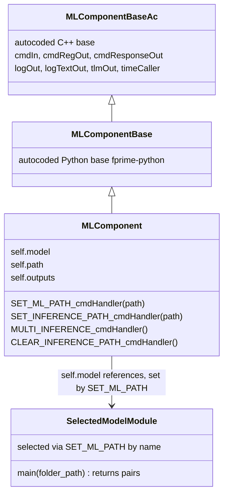
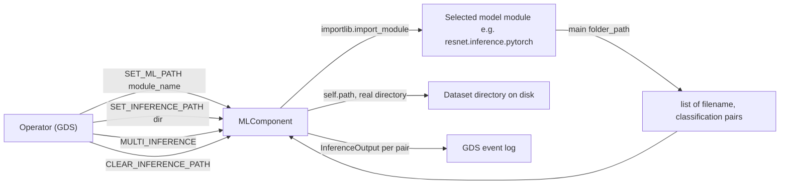
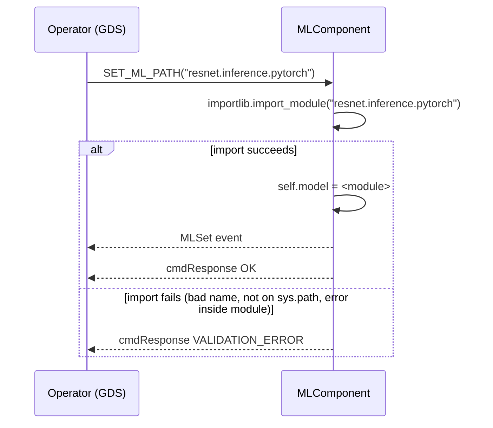
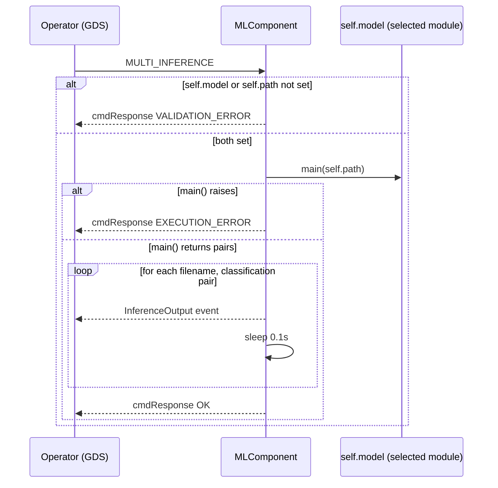

# Components::MLComponent

An operator-driven tool for running a machine-learning inference script
against a folder of data and reporting the results back through GDS. It is
instantiated once in `JetsonDeployment` as `jetson_mlManager`
([JetsonDeployment/Top/instances.fpp:22](../../../JetsonDeployment/Top/instances.fpp)),
since the Jetson is the board with the GPU and the ML/PyTorch software stack
in this deployment.

`MLComponent` is implemented in Python using
[fprime-python](https://github.com/fprime-community/fprime-python/tree/c362eea68467a5fb7190943b02b73d4b01e941fe),
not C++. This document records the implemented design, explains why the
commands behave the way they do (some of it is genuinely unintuitive from
the names alone), and walks through how to add a new model, select it, and
point it at a dataset.

## Design Summary

### Why this component is Python instead of C++

Every other component in this codebase is C++. `MLComponent` is the one
exception, and the reason is upstream, not architectural preference: the
actual inference code lives in `Scales-ML` (a nested git repository under
`Components/MLComponent/Scales-ML/`) and is written against `torch`,
`transformers`, and `datasets` -- the standard Python ML ecosystem. Those
libraries don't have a C++ equivalent worth reimplementing against; the
practical way to run a HuggingFace model is to run Python. fprime-python
exists precisely for cases like this: it autocodes the same
port/command/event plumbing any F Prime component gets from its `.fpp` file,
but lets the handler bodies be written in Python instead of C++, so this
component can call directly into `Scales-ML`'s scripts with no C++/Python
bridging code of its own.

Concretely, that means two files define this component, not one:
`MLComponent.fpp` declares the interface and autocodes `MLComponentBaseAc`
(C++) and `MLComponentBase` (its Python-facing counterpart, generated into
`MLComponentBaseAc.py`), and `MLComponent.py` subclasses `MLComponentBase`
and implements the four command handlers. `MLComponent.template.py` is the
blank scaffold fprime-python generates for that second file -- every handler
starts as a `# TODO: Implement command handler` stub that just replies `OK`;
compare it against `MLComponent.py` to see exactly what was filled in.

### Why `SET_ML_PATH` takes a module name, not a file path

This is the single most important, and most misleading, thing about this
component: despite the command's name and its `.fpp` doc comment ("Set the
file path for the ML model"), the string you give `SET_ML_PATH` is not a
filesystem path at all. It's a **Python module name**.

[MLComponent.py:29-46](../MLComponent.py) shows exactly what happens:

```python
def SET_ML_PATH_cmdHandler(self, opCode, cmdSeq, path):
    try:
        self.model = importlib.import_module(str(path))
    except Exception:
        ...VALIDATION_ERROR...
```

`importlib.import_module(name)` is the same call Python's own `import name`
statement uses internally. It only succeeds if `name` is something Python
can already find on `sys.path` -- it does not search the filesystem for a
file matching the string you typed, and it will happily accept a name that
doesn't look like a path at all (`resnet.inference.pytorch`, not
`/home/.../resnet/inference/pytorch.py`). If it succeeds, whatever module object
comes back is stored as `self.model` and an `MLSet` event is logged; if it
raises for any reason (typo, module not on the path, import-time error
inside the module itself), the command is rejected with `VALIDATION_ERROR`
and nothing is stored.

Because `self.model` is a live Python module reference, whatever it points
to is exactly what `MULTI_INFERENCE` will later call `.main()` on -- see
below.

### Why `SET_INFERENCE_PATH` is different -- it really is a path

`SET_INFERENCE_PATH` is not the same kind of value. Its job is to say *where
the data to run inference on lives*, and that genuinely is a directory on
disk:

```python
def SET_INFERENCE_PATH_cmdHandler(self, opCode, cmdSeq, path):
    path_str = os.path.abspath(str(path))
    if not os.path.isdir(path_str):
        ...VALIDATION_ERROR...
    self.path = path_str
```
([MLComponent.py:48-66](../MLComponent.py))

`os.path.abspath()` first turns a relative argument into an absolute path,
resolved against F Prime's working directory on the Jetson
(`build-artifacts/python`, set by `jetson-startup.sh`). For example,
`./Images` becomes `<repo>/build-artifacts/python/Images` and
`../../test-imagery` becomes `<repo>/test-imagery`. The absolute path is
what gets stored, what the `InferenceSet` event reports, and what the
model's `main()` receives, so the operator always sees exactly which folder
was selected.

`os.path.isdir()` is a real filesystem check -- the string must name a
directory that exists on the machine `MLComponent` is running on (the
Jetson) at the moment the command runs. There's no relationship between
this value and `SET_ML_PATH`'s value beyond both being called "path" in the
`.fpp`; one selects *which code runs*, the other selects *what data it runs
against*. Treat them as two independent settings, not two parts of one
configuration.

### The contract every model module must satisfy

`MULTI_INFERENCE` is what actually connects the two settings above:

```python
def MULTI_INFERENCE_cmdHandler(self, opCode, cmdSeq):
    if self.model is None or self.path is None:
        ...VALIDATION_ERROR...
    try:
        self.outputs = self.model.main(self.path)
    except Exception:
        ...EXECUTION_ERROR...
    if self.outputs:
        for file, classification in self.outputs:
            self.log_ACTIVITY_HI_InferenceOutput(str(file), str(classification))
            time.sleep(0.1)
```
([MLComponent.py:68-99](../MLComponent.py))

This is a hard, undocumented-elsewhere interface contract: whatever module
you select with `SET_ML_PATH` **must** define a top-level function

```python
def main(folder_path) -> Iterable[tuple[str, str]]:
    ...
```

that accepts the dataset directory (the value from `SET_INFERENCE_PATH`) and
returns something iterable of `(filename, classification)` pairs. Each pair
becomes one `InferenceOutput` event, logged with a `0.1`-second sleep
between each (a simple pacing measure so a large batch doesn't flood the
event pipeline downlink all at once). If `self.model.main()` raises for any
reason -- missing dependency, bad data, out-of-memory on the GPU, whatever
-- the command comes back `EXECUTION_ERROR` and no events are logged for
that run. The exception's message is discarded (the handler uses a bare
`except Exception:` and logs nothing), so the operator sees only
`EXECUTION_ERROR`. To find the cause, run the same entry point by hand on
the Jetson; each one accepts an image folder on the command line, e.g.
`python3 -m resnet.inference.tensorrt <folder>`. If `main()` returns `None`
or an empty sequence, no events are logged either, but the command still
reports `OK`.

**Model modules that satisfy this contract** (Scales-ML `c49ad8f`):

| `SET_ML_PATH` value | Model | How it runs |
|---|---|---|
| `resnet.inference.pytorch` | ResNet-18 (Hugging Face), image classification | Inside F Prime's own Python process |
| `resnet.inference.tensorrt` | ResNet-18 as a compiled TensorRT engine | Subprocess under the Jetson's system Python |
| `yolo.inference.pytorch` | YOLOv8n (Ultralytics), object detection | Subprocess under the Jetson's system Python |
| `yolo.inference.tensorrt` | YOLOv8n as a compiled TensorRT engine | Subprocess under the Jetson's system Python |

The TensorRT entry points need a one-time engine build on the Jetson
(`make ml-trt-setup`, or `make ml-trt-setup MODEL=yolo`). Why most entry
points run in a subprocess, and how the TensorRT path works, is covered in
[scales-ml.md](scales-ml.md#flight-inference-code).

The rest of `Scales-ML` (`mnist/`, `depth/`, `nannyml/`, `phi3/`, and the
scripts directly in `resnet/` such as `resnet_cifar100.py` and
`resnet_fps.py`) is experiment code that does not follow this contract --
but see the caution under "Adding a New Model" about selecting it anyway.

### Why `CLEAR_INFERENCE_PATH` doesn't also clear the model

```python
def CLEAR_INFERENCE_PATH_cmdHandler(self, opCode, cmdSeq):
    self.path = None
```
([MLComponent.py:101-107](../MLComponent.py))

This resets `self.path` only. `self.model` (the imported module from
`SET_ML_PATH`) is untouched. That's a deliberate asymmetry worth calling out
because the name invites the opposite assumption: after
`CLEAR_INFERENCE_PATH`, the previously-selected model is still selected --
you only need to run `SET_INFERENCE_PATH` again before the next
`MULTI_INFERENCE`, not `SET_ML_PATH` as well. There is no command that
clears `self.model`; the only way to change the selected model is to call
`SET_ML_PATH` again with a different (or the same) module name.

## Adding a New Model

Adding a model that works with `SET_ML_PATH` means two things have to be
true at once: the module has to be *importable by name* when
`MLComponent.py` runs, and it has to expose the `main(folder_path)` contract
described above.

### 1. Make the module importable

`importlib.import_module("mymodel.inference.pytorch")` only succeeds if a
directory on `sys.path` contains `mymodel/inference/pytorch.py`, with an
`__init__.py` in both `mymodel/` and `mymodel/inference/`. Two places put
the Scales-ML root on the path at runtime, and they must agree:

- `PYTHONPATH` in [jetson-startup.sh](../../../jetson-startup.sh). The
  subprocesses started by the TensorRT and YOLO entry points inherit it.
- `add_python_paths()` in
  [JetsonDeployment/fsw_main.py](../../../JetsonDeployment/fsw_main.py):

```python
def add_python_paths():
    paths = [
        PYTHON_ARTIFACT_DIR,   # build-artifacts/python/
        PROJECT_ROOT,
        ML_COMPONENT_DIR,      # Components/MLComponent/
        SCALES_ML_DIR,         # Components/MLComponent/Scales-ML/
    ]
    for path in reversed(paths):
        if os.path.isdir(path) and path not in sys.path:
            sys.path.insert(0, path)
```

Because the Scales-ML root itself is on the path, any new package folder
under `Scales-ML/` is importable by its dotted name with no path changes and
no rebuild. (Before the Scales-ML refactor, only `Scales-ML/resnet/` was on
the path, so models had to be flat files inside that one folder.)

### 2. Match the `main()` contract

```python
def main(folder_path):
    """folder_path is exactly what was set via SET_INFERENCE_PATH."""
    results = []
    for filename in os.listdir(folder_path):
        ...
        results.append((filename, classification_string))
    return results
```

`Scales-ML/resnet/inference/pytorch.py` is the reference implementation of
this shape for a model that runs inside F Prime's own process -- copy its
pattern (list the directory, run the model per file, collect
`(filename, label)` tuples, return the list) rather than starting from
scratch. For a TensorRT model, copy `resnet/` or `yolo/` and implement the
adapter instead; see
[scales-ml.md, "Adding a new model"](scales-ml.md#adding-a-new-model).

### 3. Select it

Once both of the above are true, the model is selected the same way any
other one is:

```
SET_ML_PATH resnet.inference.pytorch
SET_INFERENCE_PATH /path/to/a/folder/of/images
MULTI_INFERENCE
```

No rebuild is needed: `importlib.import_module` happens at command time, not
at build time, so switching between models is just re-sending `SET_ML_PATH`
with a different name.

(Aside: earlier versions of `MLComponent.py` also imported
`resnet_cifar100` and `resnet_inference` at the top of the file. When the
Scales-ML refactor deleted `resnet_inference.py`, that import made the
component fail to load at startup, so both pre-imports were removed. Models
are now imported only when `SET_ML_PATH` selects them, which also keeps
`torch` and `transformers` out of flight-software startup.)

### Caution: `SET_ML_PATH` can import any Scales-ML script

Because the whole Scales-ML root is importable, `SET_ML_PATH` accepts the
dotted name of *any* script in it, not just the four entry points.
Importing a module runs its top-level code, and several experiment scripts
have no `if __name__ == "__main__":` guard:

| Name | What importing it does |
|---|---|
| `resnet.resnet_training_hg` | Starts a ResNet-50 training run, then uploads the model to Hugging Face |
| `phi3.ph3` | Loads the Phi-3.5 language model (several GB) and generates text |
| `yolo.camera`, `yolo.camera_torch` | Loads YOLO and opens the USB camera in an endless display loop. With no camera it calls `exit()`, which the handler's `except Exception` does not catch |
| `hugging_face.misc.audio` | Downloads a speech dataset and a model |
| `nannyml.estimator_test` | Reads data files from hard-coded paths |

Proposed fix (not implemented): have `SET_ML_PATH_cmdHandler` accept only
names of the form `<package>.inference.<module>`, which every entry point
follows and no experiment script does.

## Operational Notes: why there's no dropdown for these paths in GDS

Both `SET_ML_PATH` and `SET_INFERENCE_PATH` are declared `string size 254`
in [MLComponent.fpp:11-13,21-23](../MLComponent.fpp) -- plain free-text
parameters. F Prime's GDS only auto-renders a dropdown/select control for a
command parameter when its `.fpp` type is an `enum`; GDS has no mechanism
for a "dynamic" dropdown populated from something the flight software
reports live. A `string` parameter is always a free-text box.

Converting either parameter to an `enum` would get a dropdown, but at a real
cost: an `enum`'s value list is fixed at compile time. `SET_ML_PATH` would
have to be re-declared and the deployment rebuilt every time a model is
added (defeating the "add a package under `Scales-ML/` and select it"
workflow above), and `SET_INFERENCE_PATH` fundamentally can't be an `enum`
at all -- its valid values are "any directory that happens to exist on the
Jetson at the time," which isn't a fixed set. This only makes sense if the
model/dataset list is meant to be small and curated (e.g., "these are the N
flight-qualified models," changed rarely and deliberately) -- worth
considering if that becomes the operational reality, but it's a real
trade-off, not a strict improvement over today.

A lighter-weight option that doesn't require giving up flexibility: add a
read-only command (e.g. `LIST_AVAILABLE_MODELS`) that reports, via an event,
which module names are actually importable right now, so an operator can
see valid choices before typing instead of guessing or checking source.
This is a suggestion for future work, not implemented as part of this
document.

## Functional Diagrams

### Class Diagram



### Command Relationships



### Sequence: `SET_ML_PATH`



### Sequence: `MULTI_INFERENCE`



## Operating Rules

1. `SET_ML_PATH`'s argument is resolved with `importlib.import_module()` --
   it is a Python module name that must already be importable, not a
   filesystem path. Success stores the module as `self.model` and logs
   `MLSet`; failure of any kind returns `VALIDATION_ERROR` and leaves
   `self.model` unchanged.
2. `SET_INFERENCE_PATH`'s argument is converted to an absolute path with
   `os.path.abspath()` (relative paths resolve against F Prime's working
   directory, `build-artifacts/python`), then validated with
   `os.path.isdir()`; it must name a directory that exists at command time.
   Success stores the absolute path as `self.path` and logs `InferenceSet`;
   failure returns `VALIDATION_ERROR` and leaves `self.path` unchanged.
3. `MULTI_INFERENCE` requires both `self.model` and `self.path` to already
   be set, or it returns `VALIDATION_ERROR` without attempting anything.
4. `MULTI_INFERENCE` calls `self.model.main(self.path)` exactly once per
   command. Any exception raised inside that call is caught and reported as
   `EXECUTION_ERROR`; the exception's message is not reported, and no
   partial results are logged for a run that raises.
5. Each `(filename, classification)` pair returned by `main()` produces one
   `InferenceOutput` event, in the order returned, with a `0.1`-second sleep
   between events. If `main()` returns nothing (`None` or empty), no events
   are logged, but the command still reports `OK`.
6. `CLEAR_INFERENCE_PATH` resets `self.path` only. `self.model` is
   unaffected and remains selected.
7. There is no command that clears or queries `self.model`; the only way to
   change the selected model is another `SET_ML_PATH` call.

## Port Descriptions

| Name | Description |
|---|---|
| `timeCaller` | Standard AC port: requests the current time for event/telemetry timestamps. |
| `cmdRegOut` | Standard AC port: registers this component's four commands with the command dispatcher. |
| `cmdIn` | Standard AC port: receives dispatched commands (`SET_ML_PATH`, `SET_INFERENCE_PATH`, `MULTI_INFERENCE`, `CLEAR_INFERENCE_PATH`). |
| `cmdResponseOut` | Standard AC port: reports each command's completion status (`OK` / `VALIDATION_ERROR` / `EXECUTION_ERROR`). |
| `logTextOut` | Standard AC port: text form of events, for the console/text log. |
| `logOut` | Standard AC port: binary form of events (`MLSet`, `InferenceSet`, `InferenceOutput`), for GDS/downlink. |
| `tlmOut` | Standard AC port: telemetry channel output. Declared but unused -- see Telemetry below. |

`MLComponent` has no component-specific ports beyond the standard AC set --
no `run` (rate-group) port, no custom input/output ports. This follows from
what it actually is: an on-demand, operator-driven tool that only does
anything in response to a command, never on a schedule and never in
response to another component's output. The commented-out example port in
`MLComponent.fpp` ("Example port: receiving calls from the rate group") was
never uncommented, and nothing in `MLComponent.py` needs it.

## Component States

`MLComponent` isn't a formal state machine (no `state machine` construct in
the `.fpp`), but it does carry meaningful state across commands, held as
plain Python instance attributes rather than modeled states:

| Attribute | Set by | Cleared by | Meaning |
|---|---|---|---|
| `self.model` | `SET_ML_PATH` (on successful import) | Nothing -- persists until the next successful `SET_ML_PATH` | The currently-selected model module. |
| `self.path` | `SET_INFERENCE_PATH` (on successful validation) | `CLEAR_INFERENCE_PATH`, or the next successful `SET_INFERENCE_PATH` | The currently-selected dataset directory. |
| `self.outputs` | `MULTI_INFERENCE` (overwritten every run) | Nothing | The most recent inference run's raw results, kept only as an internal cache; not exposed via telemetry or a command. |

`MULTI_INFERENCE` is only accepted when both `self.model` and `self.path`
are non-`None` -- see Operating Rules.

## Parameters

| Name | Description |
|---|---|
| None | `MLComponent` has no configurable parameters (no `param` declarations in the `.fpp`). |

## Commands

| Name | Description | Failure modes |
|---|---|---|
| `SET_ML_PATH` | Selects the model to use, by Python module name, via `importlib.import_module()`. Logs `MLSet` on success. | `VALIDATION_ERROR` if the name can't be imported (typo, not on `sys.path`, or an error inside the module itself). |
| `SET_INFERENCE_PATH` | Selects the dataset directory `MULTI_INFERENCE` will run against. Converted to an absolute path (relative to `build-artifacts/python`), then validated with `os.path.isdir()`. Logs `InferenceSet` on success. | `VALIDATION_ERROR` if the given string is not an existing directory. |
| `MULTI_INFERENCE` | Runs `self.model.main(self.path)` and logs one `InferenceOutput` event per `(filename, classification)` result, 0.1s apart. | `VALIDATION_ERROR` if a model and/or dataset path hasn't been set yet; `EXECUTION_ERROR` if `main()` raises (the exception's message is not reported). |
| `CLEAR_INFERENCE_PATH` | Resets the selected dataset directory (`self.path = None`). Does **not** clear the selected model. | None -- always returns `OK`. |

## Events

| Name | Description | Format |
|---|---|---|
| `MLSet` | Logged when `SET_ML_PATH` successfully imports a module. | `"ML Path Set: {}"` -- the module name that was set. |
| `InferenceSet` | Logged when `SET_INFERENCE_PATH` successfully validates a directory. | `"Inference Path Set: {}"` -- the absolute path of the directory that was set. |
| `InferenceOutput` | Logged once per `(filename, classification)` pair returned by a `MULTI_INFERENCE` run. | `"{} is an image of a {}"` -- filename, then classification. |

There is no event logged for a `VALIDATION_ERROR`/`EXECUTION_ERROR`
rejection beyond the command response itself (visible in GDS's Commands
view, not the Events view) -- worth knowing if you're watching the Events
log specifically and a command appears to do nothing.

## Telemetry

| Name | Description |
|---|---|
| None | No `telemetry` channels are declared in `MLComponent.fpp`. `tlmOut` exists only because it's part of the standard AC port set every F Prime component gets; nothing is ever sent on it. Progress/results are only observable via the `InferenceOutput` event stream, not telemetry. |

## Unit Tests

None exist today. `CMakeLists.txt`'s entire `### Unit Tests ###` block --
`UT_SOURCE_FILES`, `UT_MOD_DEPS`, `UT_AUTO_HELPERS`, and the
`register_fprime_ut()` call itself -- is commented out
([CMakeLists.txt:55-65](../CMakeLists.txt)), and there is no `test/ut/`
directory under `Components/MLComponent/`. `register_python_component(...)`
is also commented out, for a separate, already-diagnosed reason noted
in-line in the CMakeLists (the direct call fails during F Prime's
info-cache sub-build because `pybind.cmake` isn't loaded in that pass yet).

If test coverage is wanted here, the natural targets -- given fprime-python
components can't easily be driven through a normal GTest `TesterBase`
harness -- would be Python-level (`pytest`) tests against `MLComponent.py`'s
four handlers directly, mocking `self.cmdResponse_out`/`self.log_*` the way
`MLComponentBase` would normally supply them. Not implemented as part of
this document.

## Requirements

| Name | Description | Validation |
|---|---|---|
| MLM-001 | The component shall execute the specified model upon command. | Manual / operator-verified via GDS (`MULTI_INFERENCE`). No automated test. |
| MLM-002 | The component shall monitor and report on model execution status and progress. | Partially met: per-result `InferenceOutput` events and command-response status (`OK`/`VALIDATION_ERROR`/`EXECUTION_ERROR`) exist; no progress indication *during* a long-running `main()` call (the command simply blocks until it returns). Manual / operator-verified. No automated test. |
| MLM-003 | The component shall provide parameter configuration capabilities to define model behavior. | Met via `SET_ML_PATH`/`SET_INFERENCE_PATH` (component-level configuration, not F Prime `param`s -- see Parameters). Manual / operator-verified. No automated test. |
| MLM-004 | The component shall be able to run ML models coded in Python. | Met by design (fprime-python + `importlib.import_module`). Manual / operator-verified. No automated test. |
| MLM-005 | The component shall be able to run at least 3 ML model formats. | **Implemented, pending hardware verification.** Four entry points satisfy the `main(folder_path)` contract, covering three model formats: a Hugging Face `transformers` model (`resnet.inference.pytorch`), an Ultralytics `.pt` model (`yolo.inference.pytorch`), and compiled TensorRT engines built from ONNX (`resnet.inference.tensorrt`, `yolo.inference.tensorrt`). See the table under "The contract every model module must satisfy." Not yet run end to end on the Jetson since the Scales-ML refactor. |

## Change Log

| Date | Description |
|---|---|
| --- | Initial Draft |
| 2026-07-31 | Full rewrite: documented the actual implemented behavior in `MLComponent.py` (in particular, that `SET_ML_PATH` selects a Python module by name via `importlib.import_module`, not a filesystem path -- correcting the previous draft's description). Added "Adding a New Model" (the `main(folder_path)` contract and the `sys.path`/`add_python_paths()` mechanism that governs which scripts are importable), an "Operational Notes" section answering why GDS can't show a dropdown for these commands today, class/sequence diagrams, filled-in Port Descriptions/Component States/Commands/Events/Telemetry/Requirements tables, and an honest "no unit tests exist yet" Unit Tests section. Documentation-only; no functional changes. | Luca Lanzillotta |
| 2026-11-03 | Updated for the Scales-ML refactor (`c49ad8f`): model modules are now selected by dotted package name (`resnet.inference.pytorch` etc.), with the Scales-ML root on the import path in both `jetson-startup.sh` and `fsw_main.py`; replaced the model table with the four current entry points; rewrote "Adding a New Model"; documented that `SET_INFERENCE_PATH` stores an absolute path, that `EXECUTION_ERROR` discards the exception message, and that `SET_ML_PATH` can import experiment scripts that run code on import; updated MLM-005. | Luca Lanzillotta |
