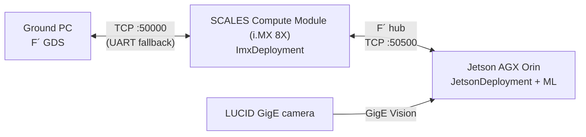

# SCALES Flight Software

Flight software reference project for the **Space Compartmentalized Autonomous Learning and Edge computing System (SCALES)**, built on NASA's [F´](https://fprime.jpl.nasa.gov) framework.

[Video demo](https://youtu.be/-g3Wv_fr9r8?si=2xow8_22aNjE1XDO) · [Full documentation](https://scales-docs.readthedocs.io/en/latest/)

**Contents:** [System overview](#system-overview) · [Prerequisites](#prerequisites) · [Setup](#setup) · [Run the demo](#run-the-demo) · [Sequences](#sequences) · [Machine learning](#machine-learning) · [Rebuild after changes](#rebuild-after-changes) · [Make targets](#make-targets) · [Troubleshooting](#troubleshooting)

## System overview



The ground system talks only to the IMX. The IMX forwards Jetson commands over the F´ hub and relays Jetson events, telemetry, and files back to the ground.

| Device | Address | Runs | Built on |
|---|---|---|---|
| Ground PC | `10.3.2.13` | F´ GDS | n/a |
| IMX | `10.3.2.10` (`eth0`), `10.3.2.11` (`eth1`) | `ImxDeployment` (starts on boot) | Ground PC (cross-compiled) |
| Jetson | `10.3.2.12` | `JetsonDeployment` (`jetson-deployment` systemd service) | Jetson (native) |
| Camera | `10.3.2.4` | LUCID GigE camera | n/a |

The custom BSP preconfigures both IMX addresses and includes a startup-enabled `ImxDeployment`. The `Makefile`, deployment topologies, and GDS scripts use `10.3.2.10` to reach the IMX.

## Prerequisites

**Hardware.** Set up each board with its guide first:

- [SCALES Compute Module](https://scales-docs.readthedocs.io/en/latest/imx8x_merger/)
- [Peripheral board](https://scales-docs.readthedocs.io/en/latest/peripheral_board/)
- [Jetson AGX Orin](https://scales-docs.readthedocs.io/en/latest/nvidia_jetson_orin_agx/)

> **Watchdog warning:** If the watchdog solder pads on the back of the Compute Module are soldered, both the IMX and the Jetson must have reference deployments installed. The Jetson's watchdog pin (GPIO27, Pin 15) must also be wired, or the Jetson will be power-cycled about every 32 seconds. Power the Jetson from its USB-C cable for first-time setup, and move to the DF11-to-DC-jack connector afterward.

**Ground PC:**

- Ubuntu 22.04
- Manual IPv4 address `10.3.2.13` with subnet mask `255.255.255.0`
- Python 3.12
- [Git LFS](https://git-lfs.com/)
- [IMX8X SDK](https://scales-docs.readthedocs.io/en/latest/imx_yocto_bsp/), installed at `/opt/ampliphy-vendor/5.0.4-devel`
- This repository cloned to `~/fprime-scales-ref`, because `make build-jetson` copies the Jetson dictionary to that path

**Jetson:**

- NVIDIA Jetson AGX Orin Developer Kit flashed with JetPack 6.2.2. `make jetson-setup` rejects versions older than 6.1 and JetPack 7.
- Ethernet port set to manual IPv4 address `10.3.2.12` with subnet mask `255.255.255.0`
- Internet access over Wi-Fi during setup

## Setup

Do these steps in order. They only need to be done once.

### 1. Set up the ground PC

```bash
git clone https://github.com/BroncoSpace-Lab/fprime-scales-ref.git ~/fprime-scales-ref
cd ~/fprime-scales-ref
make setup main
source fprime-venv/bin/activate
```

### 2. Build and deploy the IMX

The IMX toolchain reads three environment variables. Add them to `/etc/environment`, then restart the computer:

```text
IMX_C_COMPILER="/opt/ampliphy-vendor/5.0.4-devel/sysroots/x86_64-phytecsdk-linux/usr/bin/aarch64-phytec-linux/aarch64-phytec-linux-gcc"
IMX_CXX_COMPILER="/opt/ampliphy-vendor/5.0.4-devel/sysroots/x86_64-phytecsdk-linux/usr/bin/aarch64-phytec-linux/aarch64-phytec-linux-g++"
IMX_ROOT_PATH="/opt/ampliphy-vendor"
```

After the restart, build, copy the binary to the IMX, and reboot it:

```bash
cd ~/fprime-scales-ref
source fprime-venv/bin/activate
make build-imx8x
```

### 3. Set up the Jetson

Run this on the Jetson as the user the flight software will run as. Do **not** use `sudo`; the script asks for your password once.

```bash
git clone https://github.com/BroncoSpace-Lab/fprime-scales-ref.git
cd fprime-scales-ref
make jetson-setup
```

On a fresh clone, this installs Python 3.12 and Git LFS and runs `make setup` and `make arena-init` for you. It is safe to re-run, because each step skips work that is already done:

| Step | What it does |
|---|---|
| 1 | Installs system packages: Python 3.12, JRE, Git LFS, compilers |
| 2 | Creates `fprime-venv` and checks out submodules |
| 3 | Installs the LUCID Arena SDK and raises UDP receive buffers to 32 MB for the camera |
| 4 | Installs the GPU stack and `ml-venv`, caches model weights, builds TensorRT engines, and runs an accuracy self-test |
| 5 | Installs the `jetson-deployment` service and the `nvpmodel`/`shutdown` sudoers rules |

Options:

- `JETSON_USER=<name>` skips the username prompt.
- `ML_MODELS=resnet` builds only the ResNet engine. The YOLO engine takes more than 10 minutes.

<details>
<summary><strong>Why are there two Python environments?</strong></summary>

F´ runs in `fprime-venv` (Python 3.12), but NVIDIA publishes CUDA-enabled PyTorch and TensorRT for JetPack 6 only for Python 3.10. Inference therefore runs in a child process under `ml-venv`. See the [inference pipeline docs](Components/MLComponent/Scales-ML/docs/inference-pipeline.md).

</details>

### 4. Build the Jetson deployment

On the Jetson:

```bash
source fprime-venv/bin/activate
make build-jetson
```

This builds the deployment, asks for your ground PC username, copies the Jetson dictionary to the ground PC, and restarts the service. The ground PC must be reachable, or the build stops before the restart.

<details>
<summary><strong>Building without the camera</strong></summary>

Remove the camera from the build before running `make build-jetson`:

1. In `Components/CMakeLists.txt`, comment out the `RunLucidCamera` line.
2. In `lib/CMakeLists.txt`, comment out the `ArenaSDK` line.
3. In `JetsonDeployment/Top/instances.fpp`, remove the `jetson_lucidCamera` instance.
4. In `JetsonDeployment/Top/topology.fpp`, remove `instance jetson_lucidCamera` and the `jetson_lucidCamera.sendFile` connection.

</details>

### 5. Merge dictionaries and install sequences

On the ground PC, merge the IMX and Jetson dictionaries into `GDS-Dictionary/GDSDictionary.json`:

```bash
make gds-setup
```

Compile the sequences against the merged dictionary and copy them to the IMX:

```bash
for seq in Sequences/*.seq; do fprime-seqgen "$seq" -d GDS-Dictionary/GDSDictionary.json; done
make cpseq
```

The compiled `.bin` files depend on your dictionary, so don't commit them.

## Run the demo

1. **Start the GDS on the ground PC:**

    ```bash
    source fprime-venv/bin/activate
    make gds-tcp
    ```

    The GDS opens in a browser at `127.0.0.1:5000`. The connection icon at the far right turns from a red X to a green dot.

2. **Confirm that both deployments are running.** Both start on boot.

    - IMX: if the GDS stays disconnected, run `./ImxDeployment -a 0.0.0.0 -p 50000` from `/root`. You should see `Accepted client`.
    - Jetson: check with `systemctl status jetson-deployment`, and restart with `sudo systemctl restart jetson-deployment`.

3. **Test both links.** Send these commands from the GDS **Commanding** tab and look for their completion in the **Events** tab:

    ```text
    imx_CdhCore.cmdDisp.CMD_NO_OP
    jetson_CdhCore.cmdDisp.CMD_NO_OP
    ```

4. **Connect the camera.** When the camera light is flashing green, send:

    ```text
    JetsonDeployment.jetson_lucidCamera.SETUP_CAMERA
    ```

5. **Run the demo sequence.** Send `ImxDeployment.imx_cmdSeq.CS_RUN` with these arguments:

    | Argument | Value |
    |---|---|
    | `fileName` | `demo.bin` |
    | `block` | `BLOCK` |

    The sequence takes a picture, sends it from the Jetson through the IMX to the ground, classifies it with ResNet-18, and deletes the images from the Jetson.

6. **View the results.** The classification appears in the **Events** tab. Download `image.png` from the **Downlink** tab. Repeat step 5 to take more pictures.

## Sequences

Run any of these with `ImxDeployment.imx_cmdSeq.CS_RUN`:

| Sequence | What it does |
|---|---|
| `demo.bin` | Captures and downlinks an image, runs ResNet (TensorRT), then deletes the Jetson's images |
| `save-png.bin`, `snap-n-save.bin` | Captures and downlinks an image |
| `run-ml.bin` | Runs ResNet (PyTorch) on the images saved on the Jetson |
| `test-resnet.bin` | Runs ResNet (PyTorch) on the example images in `test-imagery/` |
| `batch-send-img.bin` | Compresses the Jetson's images and downlinks them as `Images.tgz` |
| `Zip-n-send-img.bin` | Legacy version of `batch-send-img.bin`. It reads `/Images`, which setup no longer creates |

## Machine learning

The models live in the [Scales-ML](https://github.com/BroncoSpace-Lab/Scales-ML) submodule. All of them run on the GPU in `ml-venv`, offline, using the weights and engines cached by `make jetson-setup`.

| `SET_ML_PATH` value | Model | Runtime |
|---|---|---|
| `resnet.inference.pytorch` | ResNet-18 (classification) | PyTorch on CUDA |
| `resnet.inference.tensorrt` | ResNet-18 (classification) | TensorRT FP16 (fastest) |
| `yolo.inference.pytorch` | YOLOv8n (object detection) | PyTorch on CUDA |
| `yolo.inference.tensorrt` | YOLOv8n (object detection) | TensorRT FP16 |

To run a model by hand, send these three commands:

```text
JetsonDeployment.jetson_mlManager.SET_ML_PATH        resnet.inference.pytorch
JetsonDeployment.jetson_mlManager.SET_INFERENCE_PATH ./Images
JetsonDeployment.jetson_mlManager.MULTI_INFERENCE
```

Relative paths resolve from `build-artifacts/python` on the Jetson. Results appear in the GDS **Events** tab and the service log (`journalctl -u jetson-deployment -f`), for example `cello.jpg is an image of a cello, violoncello (99.7%)`.

`SET_ML_PATH` only accepts names of the form `<model>.inference.<runtime>`. Anything else returns `VALIDATION_ERROR` without being loaded.

Maintenance commands, run on the Jetson:

```bash
make ml-check                  # Verify CUDA and model accuracy
make ml-setup                  # Re-run the GPU/ML setup
make ml-trt-setup              # Rebuild the ResNet TensorRT engine
make ml-trt-setup MODEL=yolo   # Rebuild the YOLO TensorRT engine
```

After a JetPack or TensorRT update, delete `~/.scales_trt_cache` and run `make ml-setup`. For design details, see [the Scales-ML integration docs](Components/MLComponent/docs/scales-ml.md).

## Rebuild after changes

**If you changed `JetsonDeployment`,** run this on the Jetson:

```bash
make build-jetson
```

**If you changed `ImxDeployment`,** run this on the ground PC:

```bash
make build-imx8x
```

Add `nogen` to either command to skip CMake generation when no build files changed.

**After either rebuild,** wait for the device to come back up. Then update the ground PC and restart the GDS:

```bash
make gds-setup
for seq in Sequences/*.seq; do fprime-seqgen "$seq" -d GDS-Dictionary/GDSDictionary.json; done
make cpseq
make gds-tcp
```

## Make targets

Run `make help` for the full list.

| Target | Run on | Purpose |
|---|---|---|
| `setup` | Ground PC | Create `fprime-venv` and install dependencies |
| `build-imx8x` | Ground PC | Build, deploy, and reboot the IMX |
| `gds-setup` | Ground PC | Merge the IMX and Jetson dictionaries |
| `cpseq` | Ground PC | Copy compiled sequences to the IMX |
| `gds-tcp` | Ground PC | Start the GDS over TCP (`127.0.0.1:5000`). Add `ip=10.3.2.11` to use the IMX's `eth1` |
| `gds-uart` | Ground PC | Start the backup GDS over UART (`/dev/ttyUSB0`, `127.0.0.1:5001`) |
| `data-products` | Ground PC | Decode `~/Downloads/*.fdp` into `DataProducts/decoded/` |
| `requirements-check` | Ground PC | Regenerate the requirements traceability report |
| `jetson-setup` | Jetson | Run the full Jetson setup |
| `build-jetson` | Jetson | Build, send the dictionary, and restart the service |
| `ml-setup`, `ml-check`, `ml-trt-setup` | Jetson | Manage the GPU/ML stack |
| `camera-viewer-setup`, `camera-view` | Either | Set up and open the [live camera viewer](tools/lucid-live-view/README.md) |
| `camera-ip-show`, `camera-set-ip` | Either | Read or restore the camera's persistent IP |

## Troubleshooting

### Downlink hangs or crashes

A leftover `image.png` from an incomplete run can block the transfer. Delete it on the IMX, then run the demo again:

```bash
rm /root/image.png
```

Also confirm that `build-artifacts/python/Images` exists on the Jetson. `make build-jetson` creates it.

### GDS can't reach the IMX over TCP

If the network link is down, use `make gds-uart`. Only one GDS can send commands at a time, and the IMX gives UART command authority after TCP has been down for 10 seconds. Once TCP has been stable for 2 seconds, send `ImxDeployment.imx_gdsCmdAuthMux.SWITCH_TO_TCP` to switch back.

### `MULTI_INFERENCE` fails

The full reason is in the service log:

```bash
journalctl -u jetson-deployment -f
```

- **`huggingface.co ... Max retries exceeded` or `is not in the Hugging Face cache`:** the model was never cached for the service user. Inference runs offline, and the cache is per user. Run `make ml-setup` as that user.
- **`CUDA unavailable`:** the GPU stack is broken. Run `make ml-check`, then `make ml-setup`.

### Camera not found

If `SETUP_CAMERA` reports `No camera connected` or can't open the camera:

1. Close the live viewer, because only one program can control the camera at a time.
2. Run `make camera-ip-show`. The camera should be at `10.3.2.4/24`.
3. If it shows a `169.254.x.x` address, restore its persistent IP with `make camera-set-ip`.

See the [camera tool docs](tools/lucid-live-view/README.md) for details.

### Streaked or washed-out images

Horizontal lines of garbage pixels mean GigE packets were lost. `SAVE_PNG` retries until it gets a complete frame and logs `Dropped N incomplete frame(s)`, or a `CameraError` warning if none arrived.

Check the camera link on the Jetson. It should report `1000` and `full`:

```bash
cat /sys/class/net/enP8p1s0/speed /sys/class/net/enP8p1s0/duplex
```

If every device on the network shows 100 Mb/s half duplex, check the strap DIP switches on the bench switch (Microchip KSZ9896C). **All strap switches must be OFF.** With `LED2_1` ON, the switch forces every port to 100 Mb/s. Turn it OFF and power-cycle the switch, because the straps are only read at reset. See Table 3-3 of the KSZ9896C datasheet (DS00002390C).

### Blurry images or poor classification

Adjust the lens focus ring, using `make camera-view` to help. ResNet accuracy depends on a sharp, well-exposed, centered object from one of the 1,000 ImageNet classes.
